# What's New in 1.12.0

This release brings together the features and improvements added since 1.11.13, including those previously described in 1.11.24. Availability of protection settings and signals depends on the relay model and firmware.

> Screenshots illustrate features introduced during the 1.11.x development cycle and included in 1.12.0. The version shown inside each screenshot identifies the build used. Click any image to open it at full size.

<!-- Reviewed source range: Pishtaz211 v1.11.13..65365ce6d (version 1.11.37). -->

---

## 🗂️ Work with Several Relays in One Window

[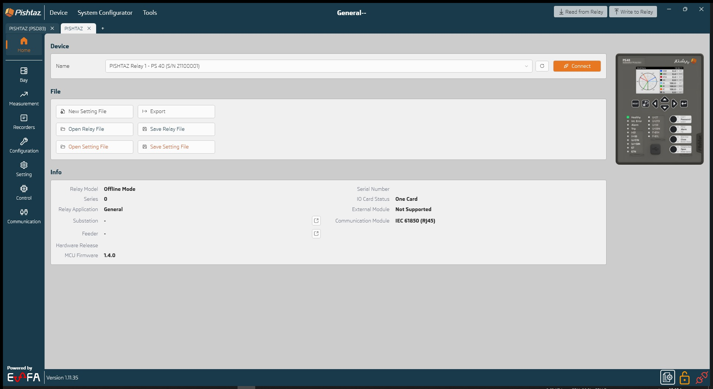](../../images/release-notes/v1.12.0/document-tabs.jpg)

*Several offline relay documents open in independent tabs.*

- Open several relays or setting files as separate document tabs and switch between them without closing the current workspace.
- Each tab keeps its own settings, navigation, connection, and unsaved changes. Closing one tab leaves the others open.
- The opened relay or setting file is identified below the title bar, making it easier to keep track of the document being edited.
- Inactive offline workspaces can be suspended and restored to reduce memory use while preserving edits.

----------------------

## 🔌 Identify Relays Before Connecting

[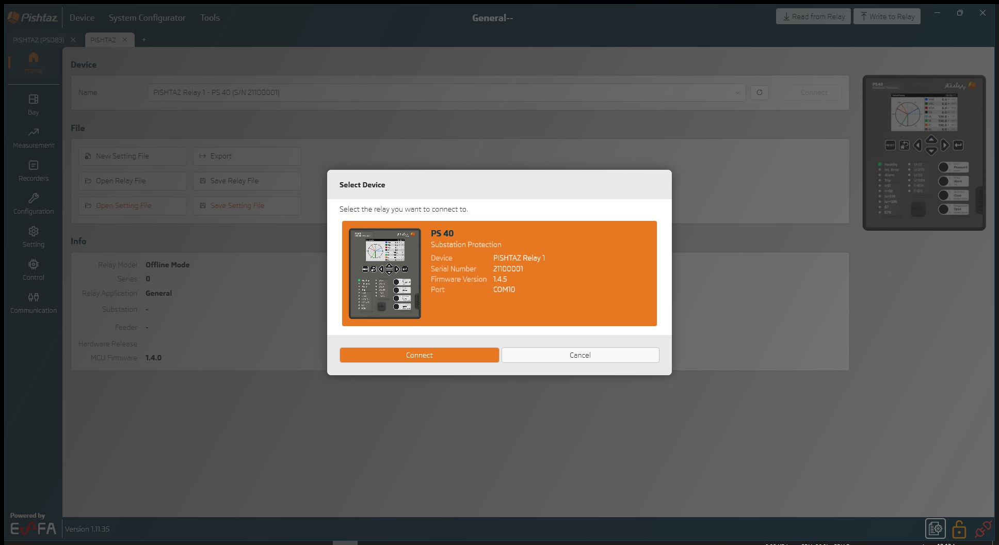](../../images/release-notes/v1.12.0/device-picker.jpg)

*Identify the relay before connecting.*

[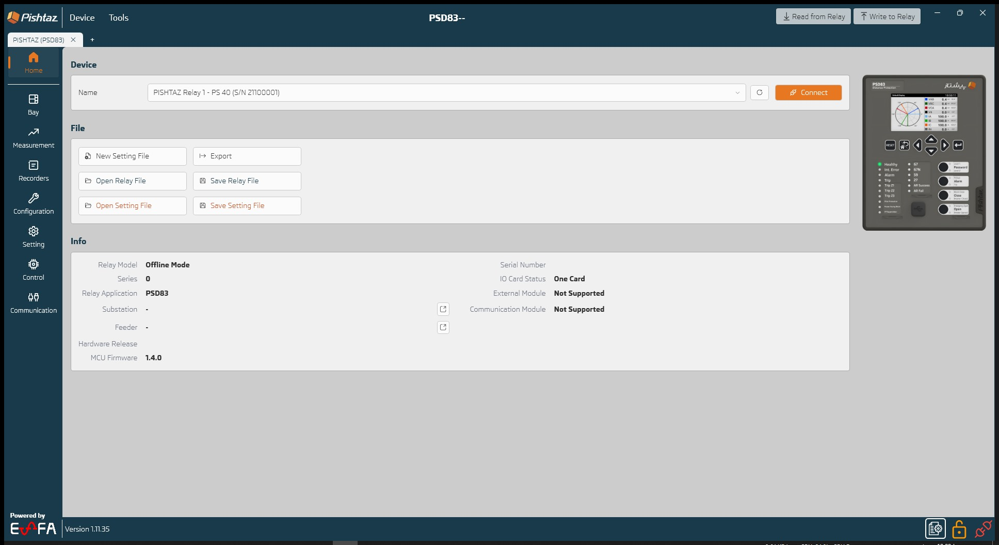](../../images/release-notes/v1.12.0/home.jpg)

*Redesigned Home page with relay identification and device information.*

- The **Select Device** dialog shows detected relay models, serial numbers, firmware versions, and front-panel images when identification succeeds.
- Device labels include the model and serial number, helping distinguish relays connected to different ports.
- A Refresh action is available for the serial-port list. Relay identity is checked again when a port is taken over by another device.
- The redesigned Home page shows a readable device identity while connected and adapts its information and front-panel layout to smaller windows.
- PSD83 is now available as a distinct selectable relay model.

----------------------

## 📈 Combined Distance Characteristic Charts

[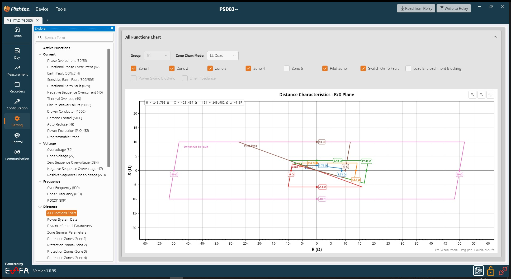](../../images/release-notes/v1.12.0/distance-chart.jpg)

*Combined distance characteristics with per-zone selection and R/X axis values.*

- The new **Distance > All Functions Chart** page brings protection Zones 1–5, Pilot Zone, Switch-on-to-Fault (SOTF), Load Encroachment Blocking, Power Swing Blocking, and the line impedance vector onto one R/X plane.
- Show or hide individual characteristics and choose the LL/LG and quadrilateral/Mho modes to compare the relevant protection areas. Zone colors remain consistent when other zones are hidden.
- Zoom, pan, and automatic fitting make the characteristics easier to inspect. Fitting accounts for the chart size and the line impedance vector.
- Pilot Zone and SOTF also have their own impedance charts. Power Swing Blocking and Load Encroachment Blocking gain dedicated charts, with the reverse load sector distinguished by hatching.
- Distance reactance settings are labeled as secondary values and show their primary equivalents using the CT/VT ratios, including the Source Impedance settings.
- Quadrilateral and Mho geometry, axis limits, and disabled-zone selection were corrected to better reflect the configured relay characteristic.

----------------------

## 📡 Expanded Distance and Tele-Protection Settings

[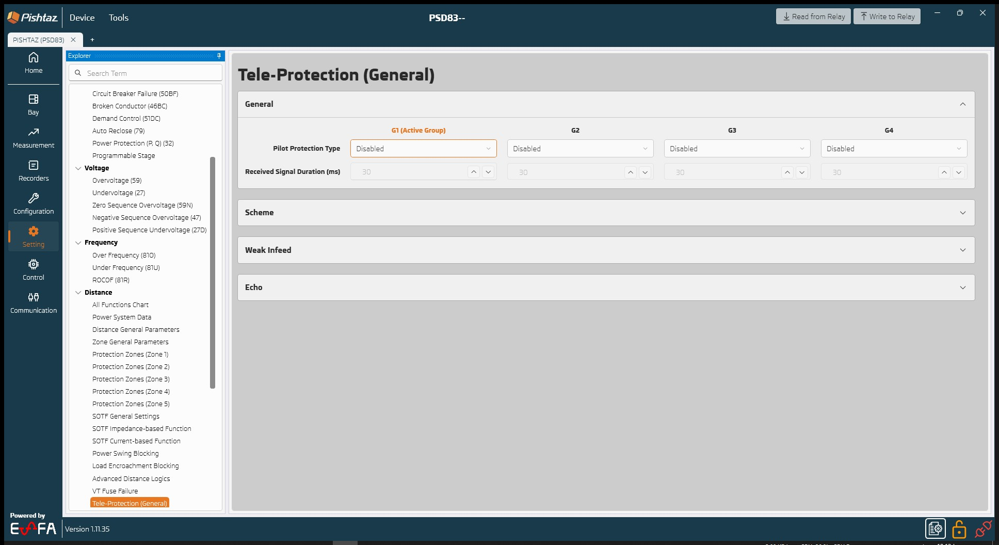](../../images/release-notes/v1.12.0/teleprotection-new.jpg)

*Tele-Protection settings with active-group headings, scheme, weak infeed, and echo.*

- Tele-Protection pages now include carrier-channel settings, received-signal logic, echo, weak-infeed, current-reversal, and aided directional earth-fault settings.
- Configure carrier inputs and channel-fault inputs for up to three channels where supported. Received-signal logic becomes available when at least two carrier channels are configured.
- Pilot-zone-dependent settings follow the selected scheme and are disabled when the scheme is Disabled or DTT.
- Separate **LL Delay** and **LG Delay** settings are available for the distance zones and Pilot Zone.
- Auto-Reclose Synchro Check gains a **maximum frequency difference** setting.
- VT Fuse Failure gains CVT MCB inputs for phases A, B, and C, with input choices matched to the relay's available digital inputs.
- Distance relays gain Line Thermal Overload settings, including environmental conditions and temperature limits, together with Cyber Security and Source Impedance pages.
- Distance functions can now be assigned in the Blocking matrix. Additional distance and tele-protection signals, including SOTF pickup and trip, are available in the output and LED matrices.
- Fault-record signal coverage and ordering were updated for the distance protection functions.

----------------------

## 🔀 Analog Logic Gates and Programmable Stages

[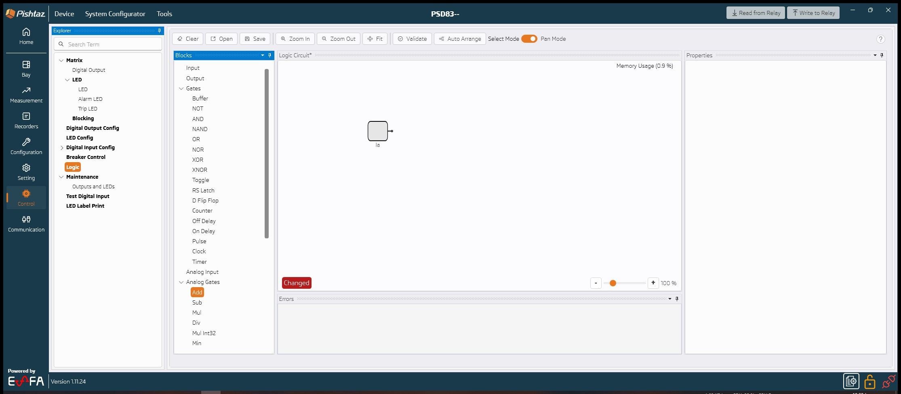](../../images/release-notes/v1.12.0/analog_gates.jpg)

*Illustration from 1.11.24, when analog logic was introduced.*

- Build analog and digital logic in the same diagram, with support for up to 10 analog gates.
- Analog functions include arithmetic, minimum/maximum, comparison, limiting, setpoint, absolute value, square root, live-zero, deadzone/hysteresis, and multiplexers.
- Use measurements, RTD and GOOSE values, constants, or other analog gate outputs as inputs. Converter gates connect the analog and digital parts of a diagram.
- Multiplexer selector inputs accept digital signals and are arranged above the data inputs.
- Circuit Breaker Failure (CBF) and new Advanced Overload signals are available for logic configuration.
- Logic node names follow changes to I/O labels. Automatic layout grouping and diagram import errors were also corrected.
- The editor only allows gate sizes the relay can store (for example, AND/OR gates need at least two inputs). Diagrams that would not be stored correctly are reported when validating or saving, with a message that explains how to fix them.
- Toolbar commands that do not fit a narrow window are reachable from an overflow button.
- Programmable stages gain a second measurement input, **Coupling2**, for the supported difference-comparison conditions. The Block option is also available for the less-than condition.

----------------------

## 🐞 Logic Debug Mode

[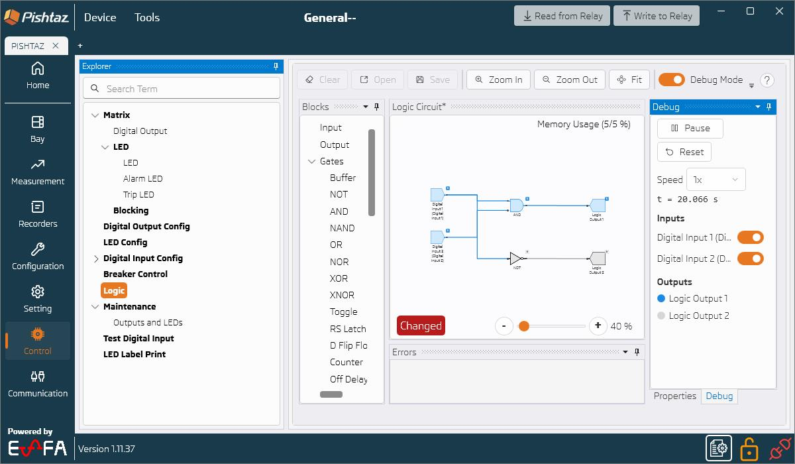](../../images/release-notes/v1.12.0/logic_debug_mode.jpg)

*Debug Mode: inputs are set by hand, every block shows its value, and active wires are highlighted.*

- Turn on **Debug Mode** in the Logic Editor toolbar to simulate the diagram on the computer, without a relay.
- The **Debug** tab lists the diagram's inputs and outputs. Switch inputs on and off, or type analog values, and watch the result reach the outputs.
- Each block shows its current value. Active gates are filled and wires carrying 1 are drawn in blue.
- Timers, counters, latches, and clocks run in simulated time. **Pause**, **Reset**, and a **1x / 10x / 100x** speed selector help follow time-dependent logic.
- The diagram is read-only while debugging, so a test cannot change it by accident. Turning Debug Mode off returns the editor to normal.

----------------------

## 🔥 Advanced Overload and Power Protection

[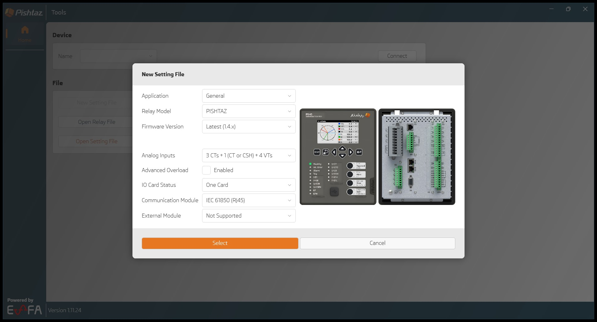](../../images/release-notes/v1.12.0/advanced_overload.jpg)

*Advanced Overload option when creating a setting file. Illustration from 1.11.24.*

[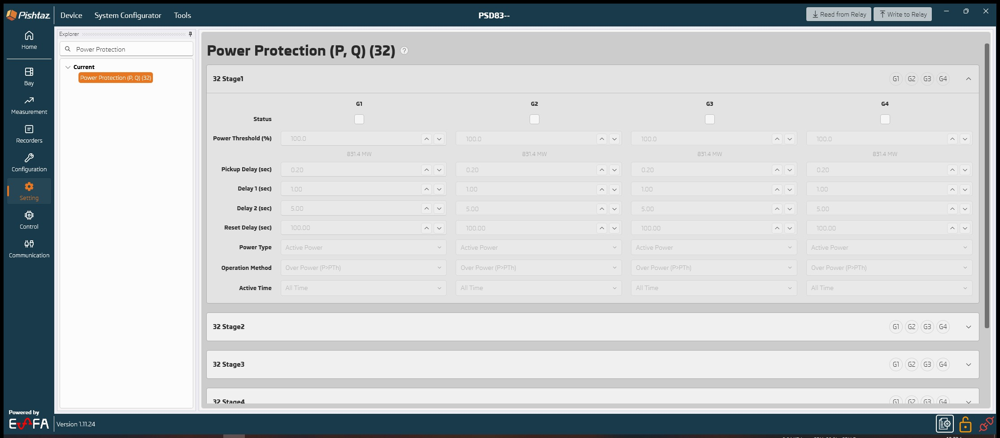](../../images/release-notes/v1.12.0/reset_delay.jpg)

*Reset Delay in Power Protection settings. Illustration from 1.11.24.*

- Advanced Overload support is read from the device model and retained in setting files. The new-file option follows firmware support.
- Advanced Overload Pickup can be assigned to output relays, LEDs, and blocking sources.
- Advanced Overload Alarm/Trip LED settings and the missing maximum overload current setting were corrected.
- All six Power Protection stages gain a **Reset Delay** setting.
- Overload names no longer lose the final characters of their supported text length.

----------------------

## 📐 User Defined Curve Guide and Preview

[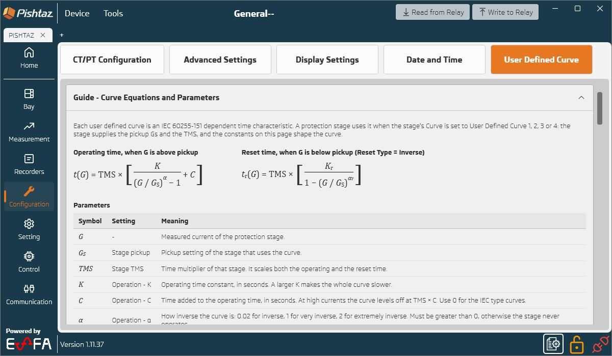](../../images/release-notes/v1.12.0/user_defined_curve_guide.jpg)

*The guide explains the curve equations and every parameter.*

[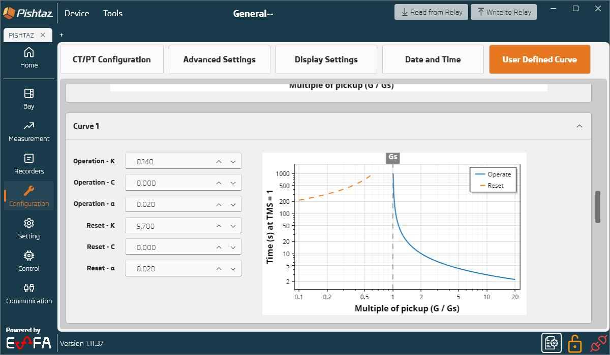](../../images/release-notes/v1.12.0/user_defined_curve_chart.jpg)

*Each curve shows its operate and reset characteristic as the constants are edited.*

- **Configuration > User Defined Curve** opens with a guide to the IEC 60255-151 operating and reset time equations and what each constant does.
- The constants of the standard IEC 60255-151 curves are listed and plotted for reference; enter them in a user defined curve to reproduce a standard curve.
- Each of the four curves has a live chart of its operate and reset times against the multiple of pickup, updated as the constants change.

----------------------

## 📋 Bay Editor Copy and Paste

[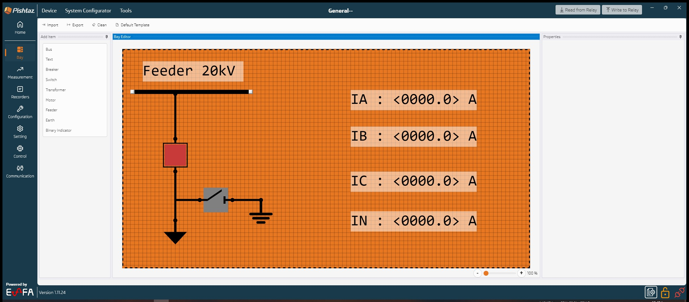](../../images/release-notes/v1.12.0/bay_editor.jpg)

*Illustration from 1.11.24.*

- Copy and paste bay elements to build repeated parts of a single-line diagram.
- Place up to **32 binary indicators**, increased from 10.
- Ring couplers are included in generated single-line diagram schemes.
- Importing an empty bay diagram no longer crashes the application.
- Bay writing was corrected, including the case where a diagram's size was an exact multiple of a transfer page.

----------------------

## 🗃️ Data Model Bulk Editing and Point Capacity

[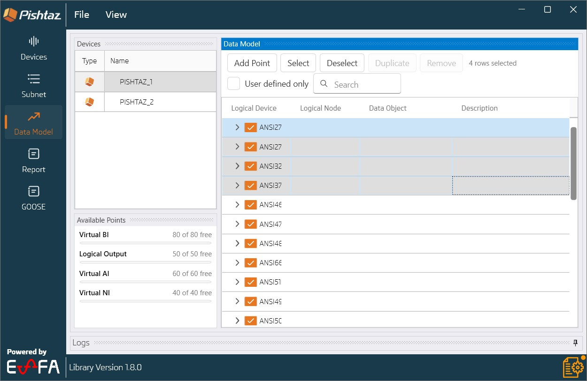](../../images/release-notes/v1.12.0/datamodel_bulk_actions.jpg)

*Illustration from 1.11.24, when these Data Model controls were introduced.*

- Select multiple Data Model rows and enable or disable them together with **Select / Deselect**.
- Duplicate user-defined and GOOSE input points. Each duplicate is labeled with its own index.
- Enable or disable user-defined and GOOSE input points, and edit user-defined point parameters after creation.
- The **Available Points** panel shows remaining virtual-point capacity before more points are added.
- Search and filters share a toolbar that wraps on narrow windows.
- Visible-row rendering and improved update handling reduce freezing when opening large data models, scrolling, or toggling nodes.

----------------------

## 📑 Report and Dataset Capacity Feedback

[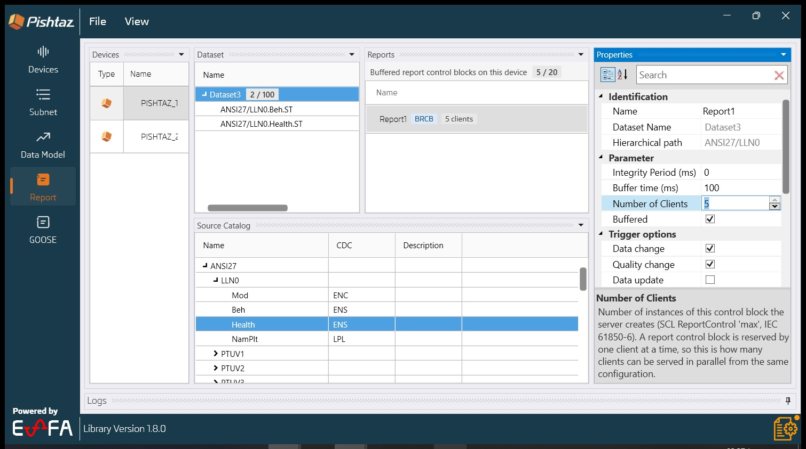](../../images/release-notes/v1.12.0/report_capacity.jpg)

*Dataset usage and buffered report capacity with client count. Illustration from 1.11.24.*

- System Configurator displays and enforces the **20 buffered report control block instance** budget. A block configured for multiple clients consumes one instance per client; unbuffered blocks do not consume this budget.
- The **100 data object per dataset** limit is shown and enforced in the Reports and GOOSE editors. Counts update when entries are removed.
- Report control blocks show their URCB/BRCB type and client count in the list.
- Report control block and GOOSE publisher properties include explanatory descriptions in the property grid.

----------------------

## 📨 GOOSE Editing and Monitoring

[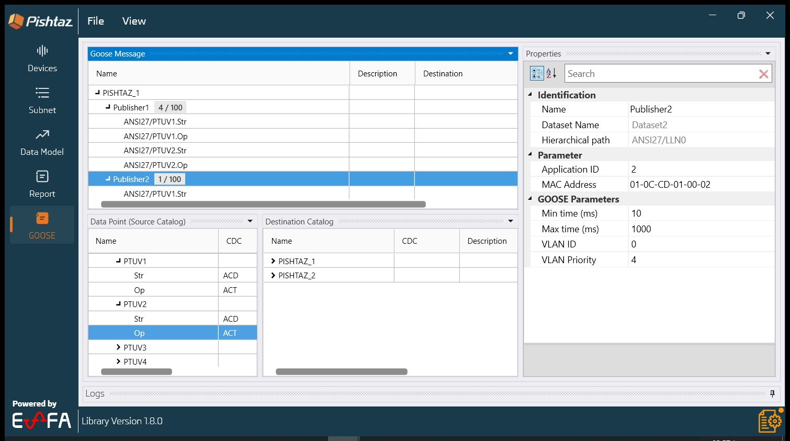](../../images/release-notes/v1.12.0/goose.jpg)

*GOOSE publishers, dataset counts, and automatically allocated MAC addresses. Illustration from 1.11.24.*

- Select and remove several publishers or published points together. A confirmation explains what will be removed, including points belonging to selected publishers.
- **Clear Destination** follows the current multiple selection.
- New publishers receive non-colliding MAC addresses, displayed in uppercase.
- Source catalogs show all GOOSE sources associated with a data object.
- GOOSE measurement reading and digital not-connected indications were corrected, and missing virtual I/O parameters are read from the device.
- The GOOSE Signals page is shown only for IEC 61850 communication. The Analog Doubles measurement tab is available again.

----------------------

## 🖥️ System Configurator Discovery and Connections

- After discovery, select several devices to read in one operation. Devices are read sequentially, and the final summary reports the results. Devices with unsaved project changes are initially left unselected.
- Firmware information is displayed for discovered devices when it can be read, refreshed during device reads, and carried over when adding a device from PISHTAZ Pro.
- Communication-module firmware templates include 2.1.8, and the latest supported version label is updated to **2.1.10**.
- Connections support both current and legacy client certificates for compatibility with different module firmware generations.
- **Continue Without** lets a connection proceed without adding an IP address to the computer's adapter when the relay is already reachable through another route.
- Read, Write, Upload, Import Certificate, and Remove operations now ask for confirmation. Discovery asks before replacing imported IED names with names read from devices.
- ICD export is possible without a subnetwork assignment, and SCD import issues were corrected.
- Shared tree-table behavior improves selection and readability across Subnet, Reports, GOOSE catalogs, and settings comparison dialogs.

----------------------

## 📝 Review Changes Before Writing

[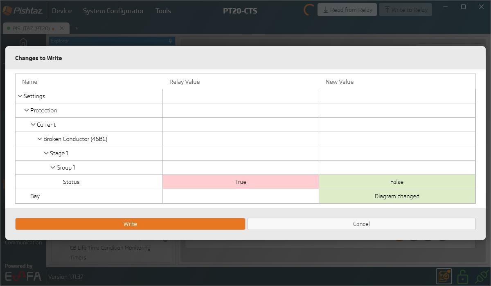](../../images/release-notes/v1.12.0/show_changes.jpg)

*Show Changes lists everything the write will send.*

- The **Write to Relay** confirmation has a new **Show Changes** button.
- It lists every changed setting under its page and function, with the value read from the relay beside the new value. Logic, fault recorder, device information, and bay diagram changes are listed too.
- Choose **Write** or **Cancel** directly from the list. Cancelling sends nothing.

----------------------

## ⚙️ Clearer Settings and Safer Editing

[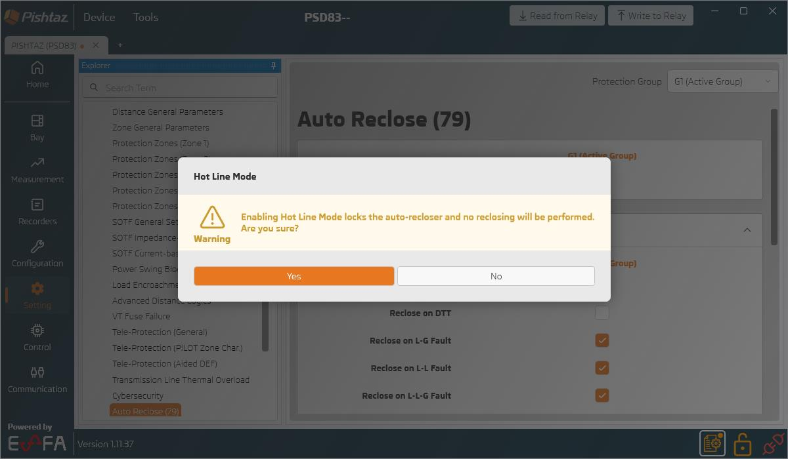](../../images/release-notes/v1.12.0/hot_line_mode.jpg)

*Enabling Hot Line Mode asks first. On a narrow window, one protection group is shown at a time, picked from the Protection Group selector.*

- Hover over a disabled setting to see which prerequisite prevents editing, including dependencies involving multiple conditions.
- Active protection groups are identified in the column headings. Narrow windows can show a single protection group for easier editing.
- Enabling **Hot Line Mode** requires confirmation.
- Values typed into numeric fields are committed before **Write to Relay**, preventing an earlier value from being sent while the field is still being edited.
- Invalid timer text is reported instead of silently reverting, and timer cells support the settings context menu.
- Expandable cards respond to clicks across the header.
- Settings ranges, defaults, equivalent values, and availability were updated to match the relay models and firmware, including PSD83-specific restrictions.

----------------------

## 📤 Fault Exports and Measurement Corrections

- Each fault in the Fault List has a new **PDF** button that exports that fault's recorded signals as a report, with charts of the analog channels and the activity of the digital signals.
- Exported COMTRADE recordings now include **.hdr** and **.inf** companion files containing relay identity and settings relevant to the capture.
- PDF reports start a new page for each fault and fault-log entry.
- Maximum/Minimum phase-C current now reads the current value rather than the phase-C voltage. The timestamp for Minimum Active Power Phase C was also corrected.
- Failed fault-list reads stop correctly instead of continuing with an unsuccessful reply.

----------------------

## 🔎 Logs, Documentation, and Reliability

[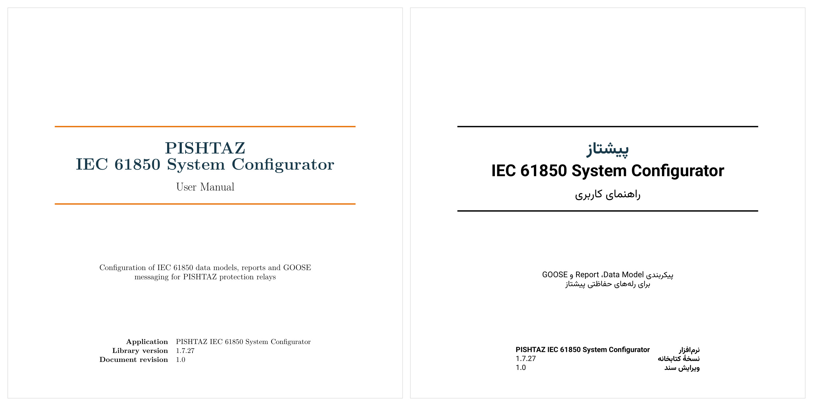](../../images/release-notes/v1.12.0/user_manual.jpg)

*English and Persian System Configurator user manuals. Illustration from 1.11.24.*

- Dev Logs supports text search, paging, a rows-per-page selector, and **Pause** to keep the displayed entries steady while new messages arrive.
- The in-memory log is capped at 1,000 entries, and the compact log display makes better use of screen space.
- System Configurator manuals are included in English and Persian; Persian tutorial walkthroughs were expanded.
- Fixed authentication-dialog password handling and errors caused by Persian or other non-ASCII text passed to the native library.
- Canceling settings comparisons or post-write review no longer surfaces as an unhandled error or a failed write.
- Menu interaction no longer accidentally drags the application window.
