# What's New in 1.12.11

This release brings together the features and fixes added since 1.12.0. It focuses on distance and tele-protection, a new COMTRADE viewer, and a redesigned System Configurator with projects, a Connections diagram, and project-wide validation. Availability of protection settings and signals depends on the relay model and firmware.

> All screenshots were taken from build 1.12.11. Click any image to open it at full size.

<!-- Reviewed source range: Pishtaz211 v1.12.0..bca7044c1 (version 1.12.11). -->

---

## 🧭 Guided Tour

[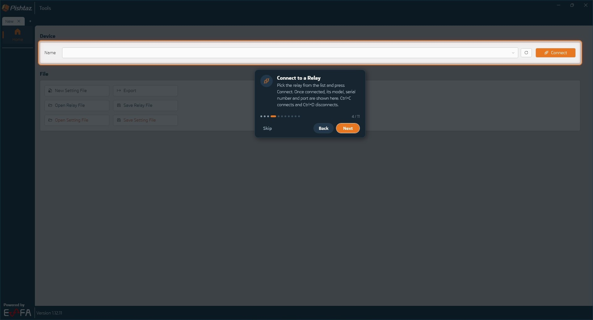](../../images/release-notes/v1.12.11/guided-tour.jpg)

*The Guided Tour points at each part of the window and explains what it does.*

- A short tour of the main window opens on the first start. It covers relay tabs, the Tools menu, connecting to a relay, working offline, relay and setting files, exports, the page rail, and the status bar.
- Move through it with **Next** and **Back** or the arrow keys, and press **Esc** to leave at any time.
- Open it again whenever you like from **Tools > Guided Tour**.

----------------------

## 📈 Distance Characteristics and Settings

[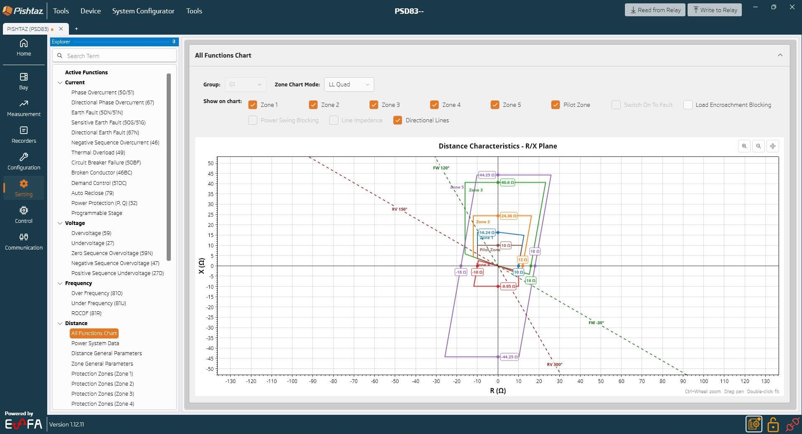](../../images/release-notes/v1.12.11/distance-directional-lines.jpg)

*The All Functions Chart now draws the forward and reverse directional lines.*

[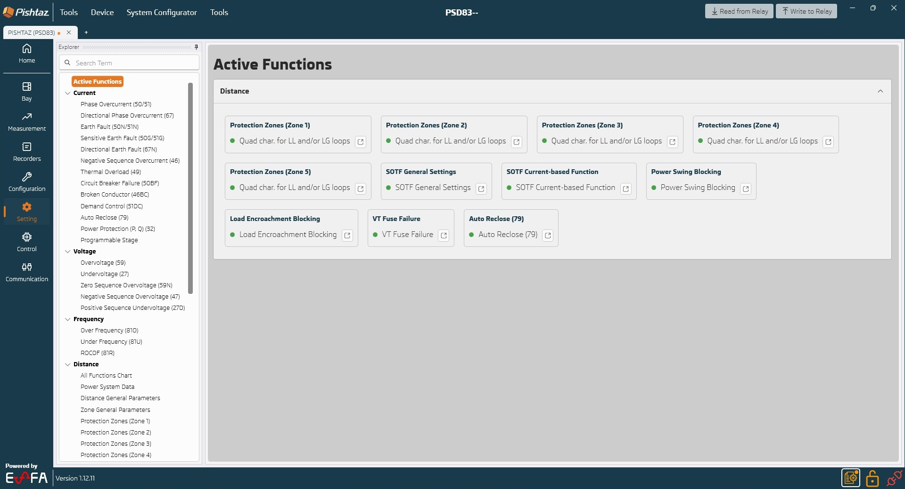](../../images/release-notes/v1.12.11/active-functions.jpg)

*Active Functions now lists every Distance function.*

- When **Direction Involvement for Zone Characteristics** is on, the **All Functions Chart** draws the lines that bound the forward and reverse fault sectors. Turn them on or off with **Directional Lines**.
- The chart checkboxes are now labeled **Show on chart:**. They only change what the chart displays, never the relay settings. The selected curves and the Zone Chart Mode stay as they are after a read from or write to the relay.
- Reverse Mho zones are now drawn as a mirror image through the origin, as the relay calculates them. Directional quadrilateral zones are limited on the left at −RF Forward, as in the current relay firmware. The chart, the XRIO export, and the COMTRADE viewer all follow these rules.
- **Active Functions** now includes Load Encroachment Blocking, Tele-Protection, Aided DEF, Transmission Line Thermal Overload, Cybersecurity, and Distance Auto Reclose. Pilot Zone and DEF are listed as active only when a comparison scheme is selected.
- Changing the **Zone Shape**, the **SOTF Protection Type**, or the **Pilot Protection Type** now offers to switch off the function statuses that the new choice makes unavailable. **Cancel** restores the previous choice.
- The SOTF general settings are disabled while the SOTF function is off.
- Primary impedance equivalents now show more decimal places: three for Ω, four for Ω/km and for the fault locator.
- Distance Auto Reclose is now blocked from the PSD83 **Blocking** matrix. The separate digital-input blocking setting on the Auto Reclose page was removed.
- New setting files start with distance auto-reclose shots 2 and 3 disabled and with SOTF delays of 10 ms. The CT, VT, and Distance default settings were also updated.

----------------------

## 📡 Tele-Protection Signals

[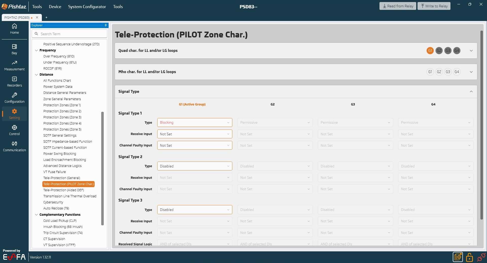](../../images/release-notes/v1.12.11/pilot-signal-types.jpg)

*After the Blocking scheme was selected, the enabled pilot signal changed to Blocking.*

- When you choose a new **Pilot Protection Type**, the group's enabled signals change to match it: **Blocking** for the Blocking scheme, and **Permissive** for POTT, PUTT, and Unblocking.
- **Write to Relay** now warns when an enabled Permissive or Blocking signal has its **Receive Input** set to **Not Set**. Such a signal is never received, so it can never permit or block an aided trip. You can disable those signals and continue writing, or go back and choose their inputs. The inputs that still need a value are highlighted.
- The **Weak Infeed** section gains block-input settings for Distance and for DEF.
- **Fixed:** the setting addresses for the Synchro Check maximum frequency difference and the weak-infeed block inputs now match the firmware. Before this fix, those values could be read from or written to the wrong relay fields.

----------------------

## 🧪 XRIO Export for Distance Testing

- Distance relays can now be exported as XRIO for test sets. The export includes quadrilateral and Mho zones, Load Encroachment, the directional boundary lines, and reverse Mho zones.
- Each zone carries its own grounding factor, and the absolute time tolerance uses the Test Universe default of 50 ms.
- Exported files now import correctly into OMICRON Test Universe and Vebko, with every value kept.

----------------------

## 📊 New COMTRADE Viewer

[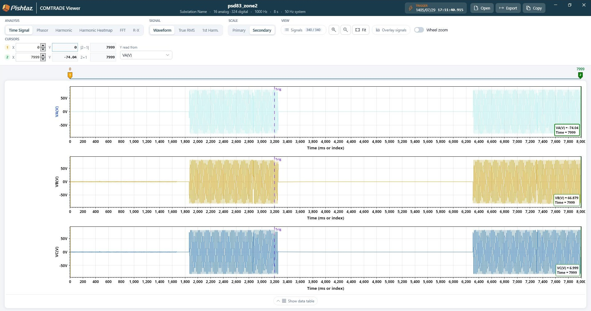](../../images/release-notes/v1.12.11/comtrade-time.jpg)

*A PSD83 Zone 2 trip record opened in the new viewer.*

[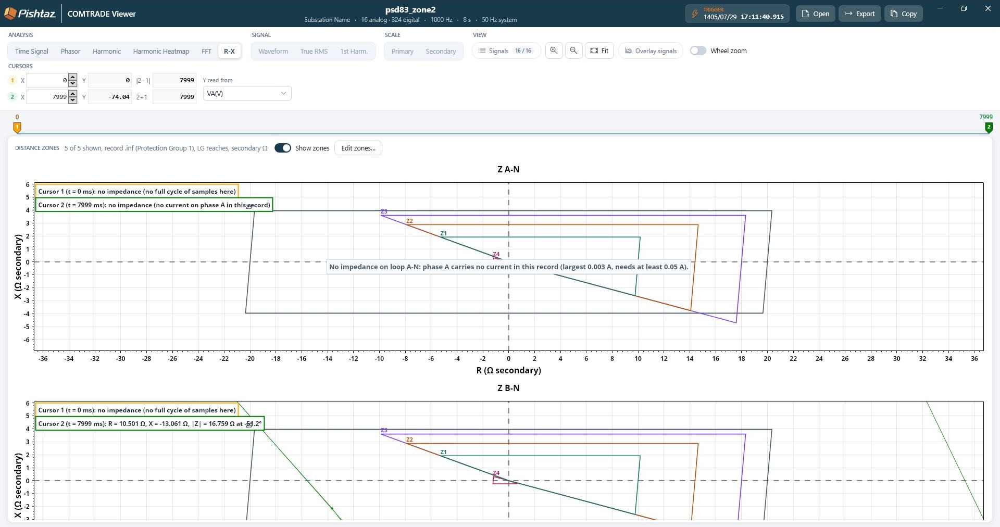](../../images/release-notes/v1.12.11/comtrade-rx.jpg)

*The R-X view draws the distance zones that were active when the fault was recorded.*

- Open the new viewer from **Tools > New COMTRADE Viewer**, or click the new-viewer button in the **Graph** column of the fault list. The existing viewer is still available and is still the default.
- The analysis views are **Time Signal**, **Phasor**, **Harmonic**, **Harmonic Heatmap**, **FFT**, and **R-X**. Waveforms can be shown as raw samples, true RMS, or fundamental values, in primary or secondary quantities.
- The **R-X** view draws the distance zones beneath the impedance trajectory. The zones are read from the PISHTAZ `.inf` file, from an OMICRON `.rio` file, or entered by hand with **Edit zones…**. When an impedance cannot be calculated, the view explains why.
- Cursors move from sample to sample. A crosshair follows the mouse and shows the signal's value, and the **Phasor** view includes symmetrical components with magnitude and angle tables.
- A signals panel lets you search, show or hide, and recolor channels. A data table shows the values at the cursors, and **Signal Inspector** gives statistics for each signal.
- Open records with **Ctrl+O** or by dragging `.cfg`, `.dat`, `.inf`, `.hdr`, or `.csv` files onto the window.
- **Fixed:** record dates are now correct on Windows set to the Persian calendar.

----------------------

## 🧾 Fault Recorder Trigger Matrix

[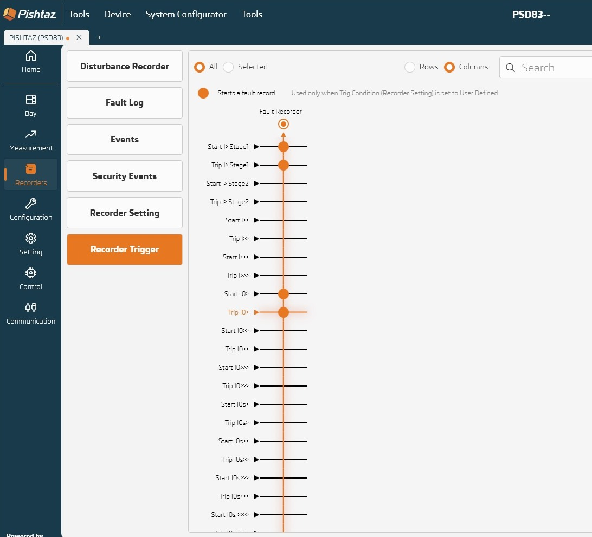](../../images/release-notes/v1.12.11/recorder-trigger.jpg)

*Choose which signals start a fault record.*

- The new **Recorders > Recorder Trigger** page lets you choose which signals start a fault record. It is used when **Trig Condition** under **Recorder Setting** is set to **User Defined**.
- Erasing the fault specification now shows its progress, and its warning explains more clearly what will be erased.

----------------------

## 🗂️ System Configurator Projects

[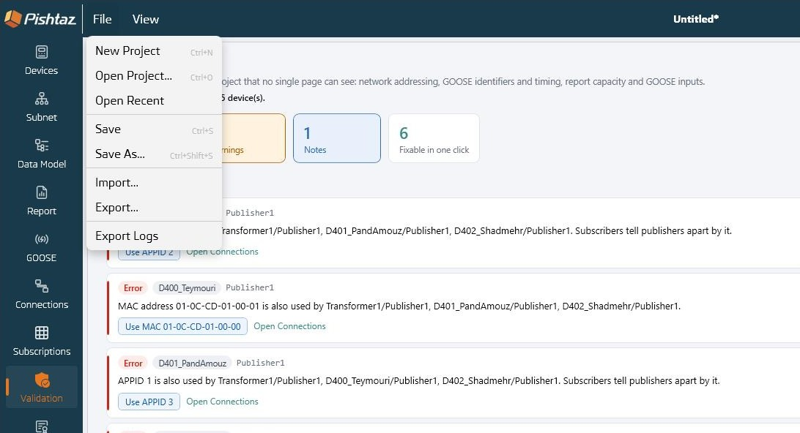](../../images/release-notes/v1.12.11/sc-file-menu.jpg)

*A project is saved as a single SCD file.*

- The System Configurator now works with **projects**. Each project is saved as one SCD file, using **New Project**, **Open Project**, **Open Recent**, **Save**, and **Save As** (Ctrl+N, Ctrl+O, Ctrl+S, Ctrl+Shift+S).
- Projects are opened and saved in their own SCL edition. **Save As** asks which edition to use.
- When there are unsaved changes, starting a new project, opening another one, or closing the window asks **Save / Don't Save / Cancel**.
- The status bar shows **Saved** or **Unsaved changes** in words. Changes to subnetworks and GOOSE subscriptions now count as unsaved changes.

----------------------

## 🔗 Connections Diagram

[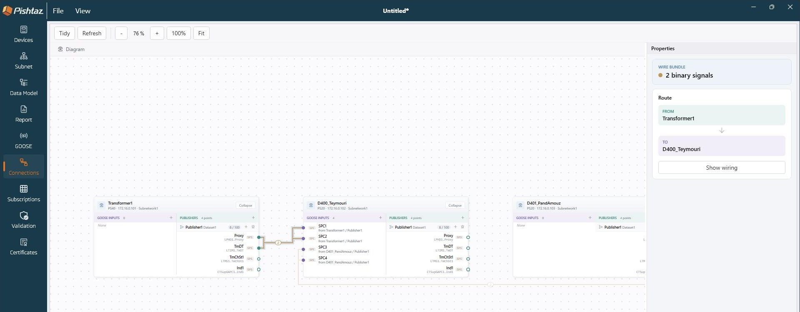](../../images/release-notes/v1.12.11/sc-connections.jpg)

*Relays as cards, GOOSE wiring as bundles, and the selected bundle's route in Properties.*

- The new **Connections** page shows every relay as a card listing its GOOSE inputs, publishers, and published points.
- The wiring between two relays is drawn as one bundle for each signal class, with a count badge, and is routed around the cards. Click a bundle to highlight it, or double-click to see its point-by-point wiring in a tab of its own.
- Create publishers and subscriptions right on the diagram: use the **+** buttons, right-click menus, or drag a published point onto a GOOSE input. If an input cannot accept a wire, the wire turns red and the reason is shown next to the cursor.

----------------------

## 📨 GOOSE Subscriptions Overview

[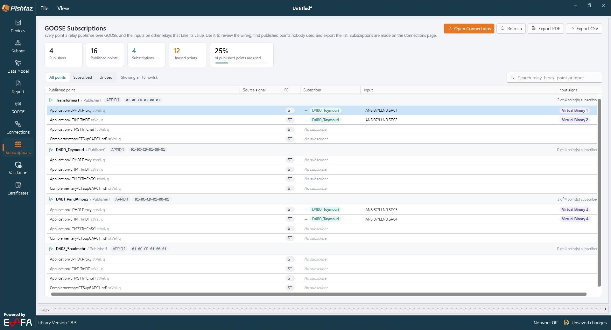](../../images/release-notes/v1.12.11/sc-subs.jpg)

*Every published point and which inputs on other relays receive it.*

- The **Subscriptions** page gives a read-only overview of all GOOSE wiring. It shows totals for publishers, published points, subscriptions, and unused points, plus a coverage bar.
- Filter by **All points**, **Subscribed**, or **Unused**, and search by relay, control block, point, or input. Rows are grouped by control block and show the APPID and MAC address.
- **Export PDF** creates a report for commissioning that lists the wiring by publisher and by subscriber. **Export CSV** is also available.

----------------------

## ✅ Project Validation and Network Check

[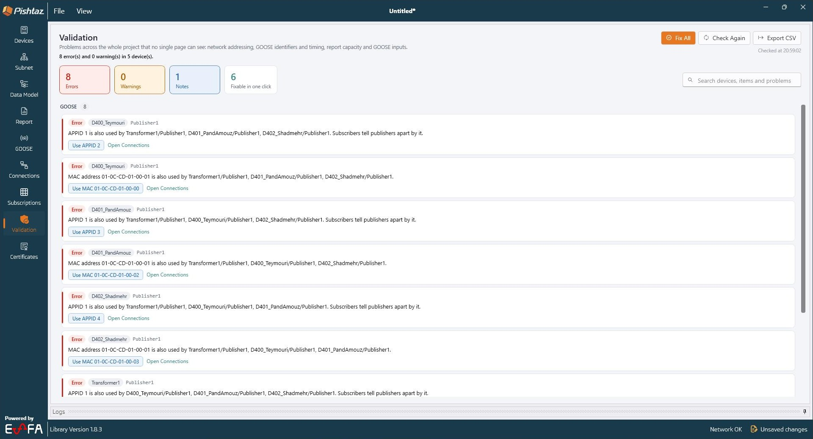](../../images/release-notes/v1.12.11/sc-valid.jpg)

*Validation lists problems across the whole project, each with a quick fix where one exists.*

[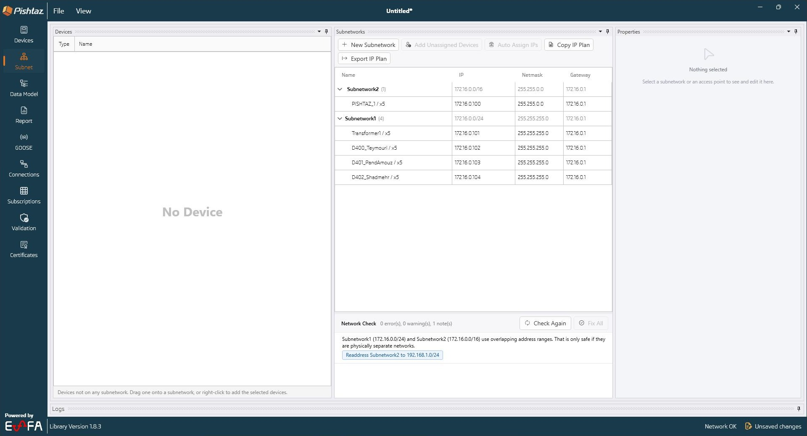](../../images/release-notes/v1.12.11/sc-subnet.jpg)

*The Subnet page checks the network and suggests fixes.*

- The **Validation** page checks the whole project: network addressing, GOOSE identifiers and timing, report capacity, and GOOSE inputs. It shows counts of errors, warnings, and notes, and how many problems can be fixed with one click.
- Each problem has quick-fix buttons, such as a free APPID or MAC address, swapping minimum and maximum times, or adding a missing report control block, plus a link to the page where it can be fixed. **Fix All** fixes problems one at a time and checks again after each one. Fixes that delete something are left for you to apply.
- The **Subnet** page adds a **Network Check** that finds devices with no subnetwork or IP address, invalid or duplicate addresses, gateway problems, overlapping ranges, and GOOSE links between different subnetworks. Each problem has a fix.
- The Subnet page also gains IP, netmask, and gateway columns, plus **New Subnetwork**, **Add Unassigned Devices**, **Auto Assign IPs**, **Copy IP Plan**, and **Export IP Plan**. Empty subnetworks are listed and can be deleted.

----------------------

## 🔐 Certificate Management

[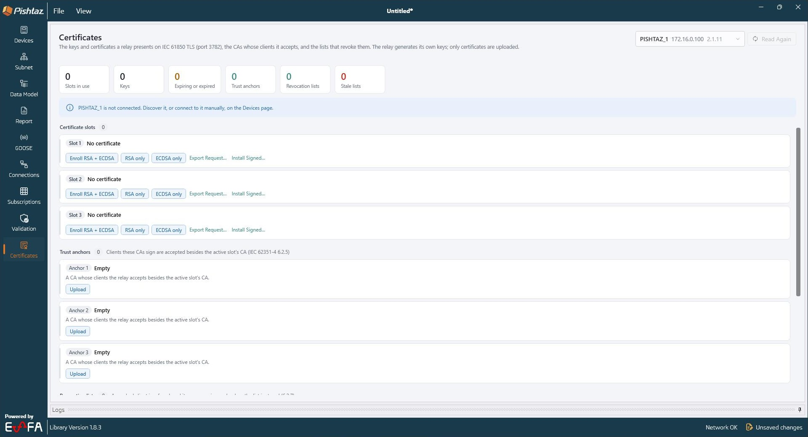](../../images/release-notes/v1.12.11/sc-certs.jpg)

*Manage a relay's IEC 61850 TLS certificates on one page.*

- The new **Certificates** page manages the keys and certificates a relay uses for IEC 61850 TLS. It is available for communication module 2.1.16 and later.
- Request certificates for a slot with RSA-2048 and ECDSA P-256 keys. The relay generates its own keys, so they never leave the device, and only the signed certificates are uploaded. A signing request can also be exported for an external CA.
- Upload, replace, or remove up to three trust anchors and three revocation lists. Expiring and expired certificates and out-of-date lists are clearly marked.
- If a relay rejects the connection because its clock is not set, you are now asked to synchronize the device time with SNTP, instead of seeing a generic connection error.

----------------------

## 🖥️ More System Configurator Improvements

- **Duplicate** a report dataset, a report control block, or a GOOSE publisher from its right-click menu.
- Add catalog points to a new or selected dataset or publisher from the right-click menu, without dragging.
- Data Model: a right-click menu, the **Delete** and **Ctrl+D** shortcuts, **Expand All / Collapse All**, and a search that narrows the results with every word you type.
- You can now search the GOOSE source and destination catalogs and the Report catalog.
- The GOOSE publisher grid shows the GoCB reference, logical device, and ConfRev. VLAN ID and priority accept the full IEEE 802.1Q range.
- **Add Device** offers optional Advanced Overload, RTD, and GOOSE supervision when the model and firmware support them. The relay panel shows whether they are enabled.
- Manual connection to communication modules older than 2.1.7 now identifies the device through discovery. User-defined points and GOOSE inputs are supported on firmware older than 2.0.2, in the form those modules use. The firmware list now names the actual released versions. PSD83 is recognized by its firmware code.
- You are asked before disabling data model items that datasets, reports, or GOOSE depend on, and before other actions that delete something.
- The System Configurator is now sharp at any display scaling and has new navigation icons.
- **Fixed:** File > New sometimes failed; the Subscriptions and Validation pages could crash on opening; Subnet rows flickered while dragging; publisher properties were not always saved; GOOSE inputs of an imported relay configuration were missing from the Data Model; GOOSE now publishes a point's status or measured value instead of its first constraint.

----------------------

## 🔧 Other Improvements and Fixes

- Matrices: **VTFF Alarm** is added to the output and LED matrices. The distance fast zone has been removed, the VT supervision cells of the distance functions are locked, and distance points appear in the same order as on the Distance setting pages.
- Fault-record and logic signals specific to distance relays are now chosen by relay model. Several distance fault-record signals were renamed to describe their behavior. The VTFF trip signals are now named **Trip Emergency OC/EF in VTFF**, and the VTFF logic option is now **V&I or MCB contacts**.
- PSD83 now has a default bay template. For a model without a template, **Default Template** shows a message and leaves the diagram unchanged.
- On PS20, the Advanced Overload breaking parameters are now always shown.
- **Show Changes** opens faster.
- PDF and Excel settings exports now follow the settings hierarchy for both four-CT and five-CT relays.
- **Fixed:** a crash when a settings snapshot contained a setting of an unexpected type, and the misspelled "Tuseday" in the timer mode.
